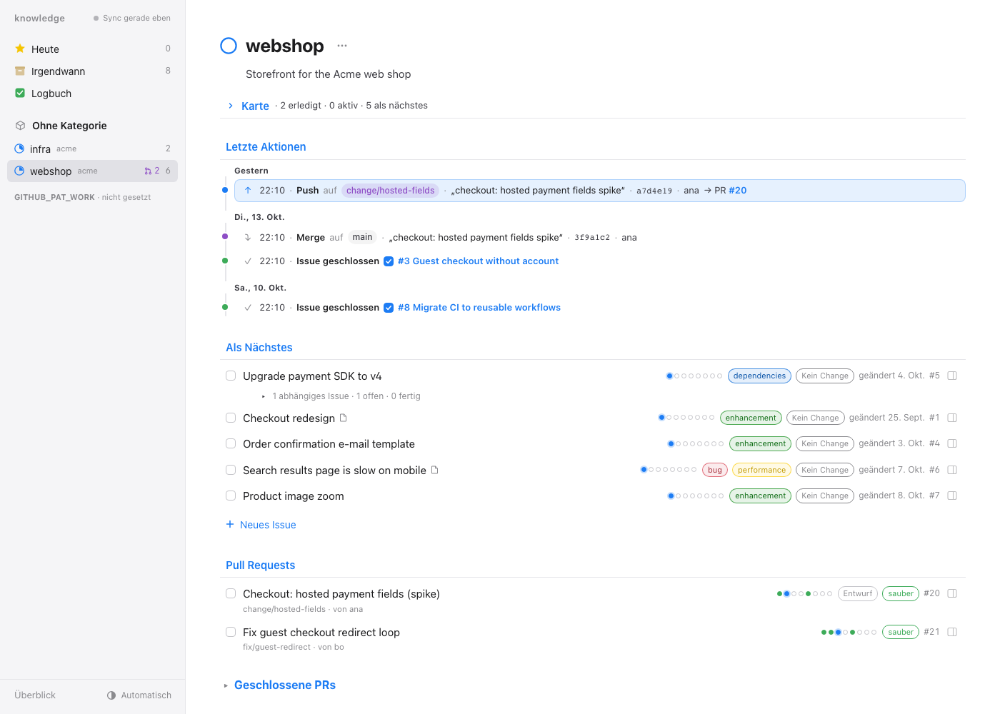
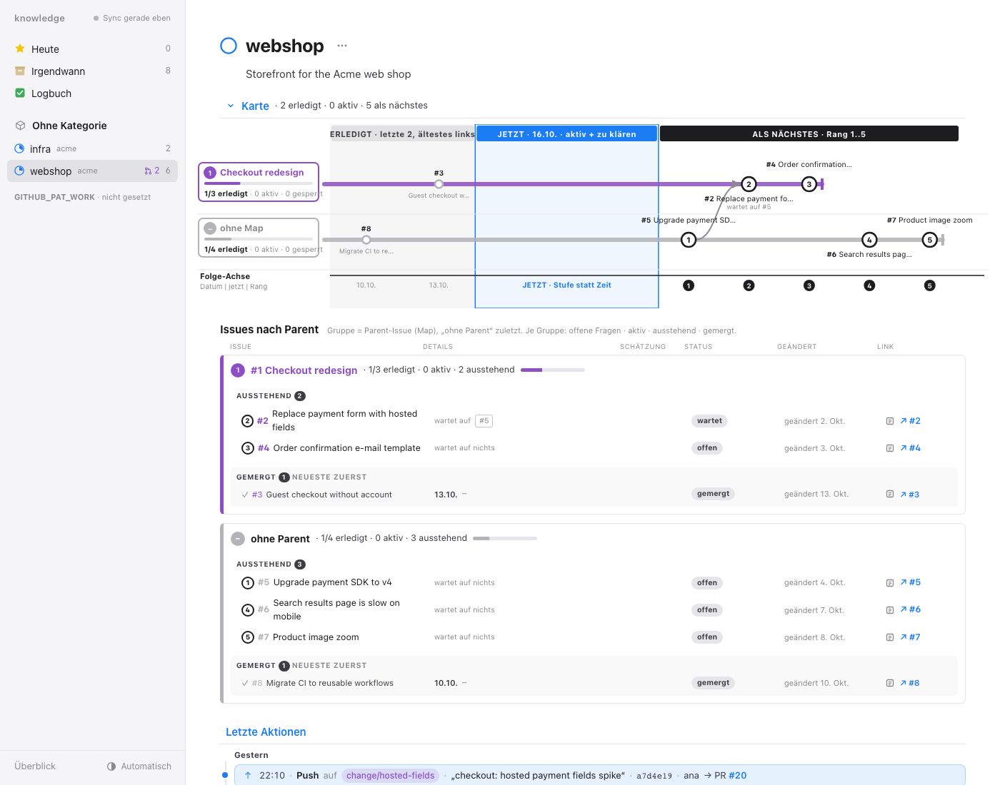
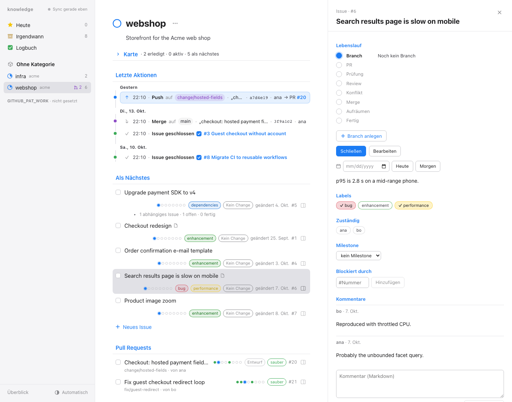
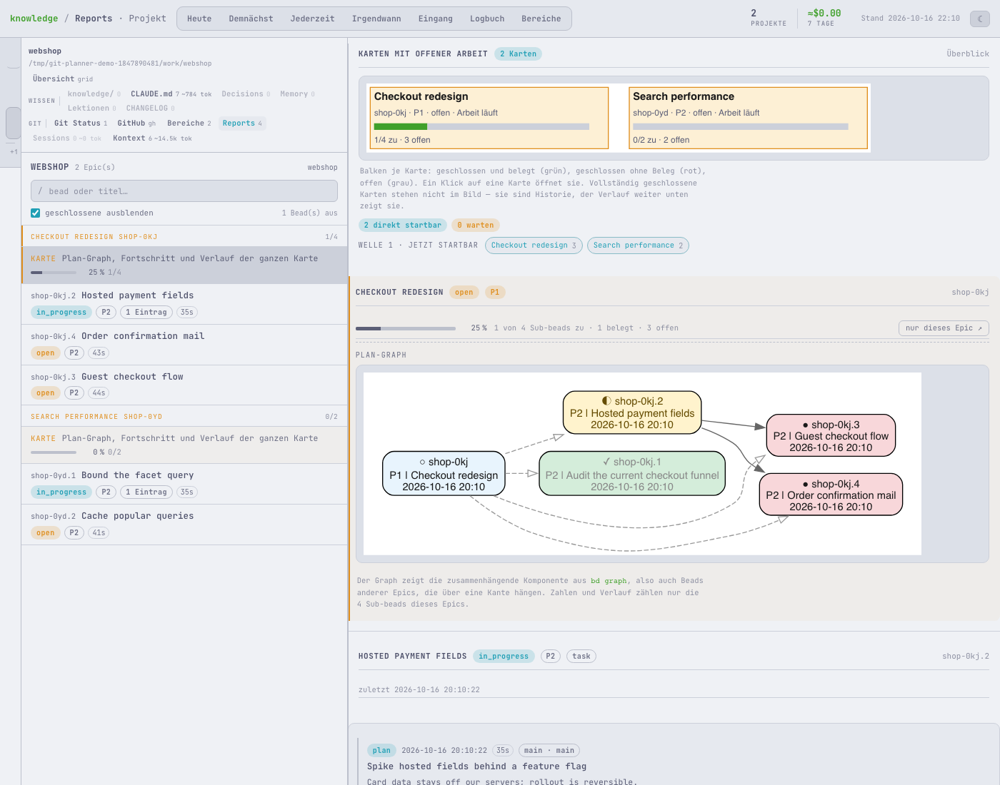
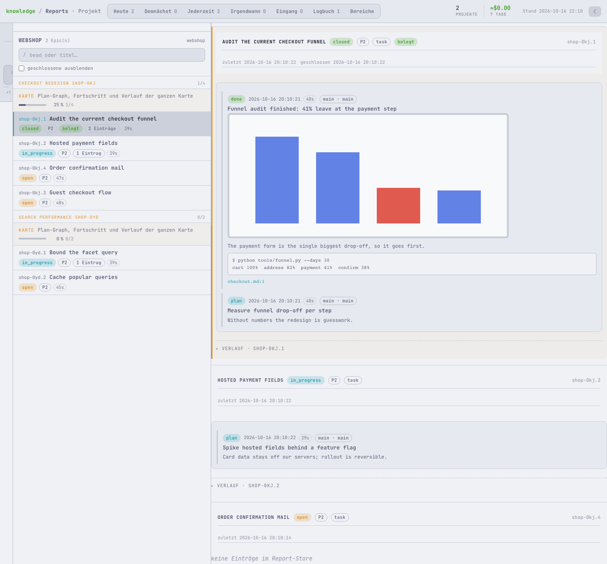
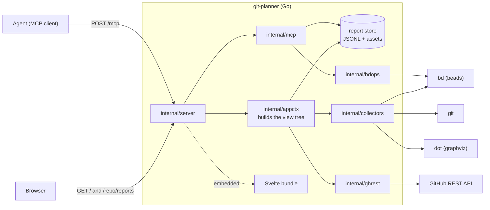

# git-planner

A single-pane planner for the work that lives in GitHub and in your repos:
issues and pull requests per repository, beads maps with evidence reports, and an
MCP endpoint through which an agent files that evidence. One Go binary, no
third-party Go modules, frontend embedded.

> The UI strings and most of `docs/` are in German; code, identifiers and this
> README are English.



All screenshots show the built-in demo mode with fictional repositories
(`acme/webshop`, `acme/infra`); no real data is involved.

## What it does

**GitHub issues and pull requests** (`/`). A repo sidebar fed by the GitHub REST
API, one view per repo: recent actions, the next issues in order, open pull
requests with check/review/conflict state, a dependency-aware issue map
(parents, sub-issues, "blocked by"), and an issue detail column for edits,
labels, assignees, comments and closing.

**beads maps with evidence** (`/<repo>/reports`). For repos tracked with
[beads](https://github.com/steveyegge/beads) (`bd`), epics labelled
`wayfinder:map` are rendered as live report views: progress per map, a plan
graph rendered by `dot` from `bd graph --dot`, and per sub-bead the evidence
entries an agent has filed (text, command output, files, screenshots).

**MCP ingest** (`POST /mcp`). JSON-RPC tools `report`, `beads_query`,
`beads_create`, `beads_update`, `beads_dep`, `beads_close`. `beads_close`
only closes a bead when a current `done` entry with visible proof (an image or a
`.dot`/`.svg` file) exists in the report store. Payloads and rules are in
[`docs/mcp-und-frontend.md`](docs/mcp-und-frontend.md).

| Issue map and ordering | Issue detail |
|---|---|
|  |  |

| beads map with plan graph | Evidence for a closed bead |
|---|---|
|  |  |

## Architecture



The MCP endpoint and the browser share no live channel: both go through the
stores on disk (report JSONL, the beads database). A view picks up new data on
page load, not by push. Selection and ordering are computed in Go
(`internal/appctx`) and tested without a browser; the frontend only draws.

## Quickstart

Requirements: Go (version in `go.mod`), `git`. For beads maps additionally `bd`
and `dot` (graphviz). Node (with pnpm) is only needed to rebuild the frontend bundle, which
is committed.

### Demo mode

```bash
go run . --demo
```

Starts the server on http://127.0.0.1:8765 against fictional data: an
in-memory GitHub API (`internal/demo`) and a throw-away workspace in a temp
directory with two git repos, beads maps and evidence reports. It touches no
real repos, tokens or `$HOME`. GitHub writes are refused in demo mode. The
temp directory is removed on Ctrl-C. `scripts/demo-screenshots.sh` regenerates
the screenshots in `docs/screenshots/` from it (needs `shot-scraper`).

### Against your repos

```bash
cp .env.example .env     # add a GitHub token, see below
go run . --cwd ~/git/some-repo
```

`--cwd` is the repository shown on start. Other checkouts are discovered under
`CC_KNOWLEDGE_ROOTS` (comma-separated, default `~/git`) and matched to the
sidebar repos by their `origin` remote.

### Container

```bash
just deploy     # gate, image, container on 127.0.0.1:8765, health check
just status | just logs | just down
```

## Configuration

Tokens are read from the environment; a `.env` in `--cwd` fills in what is
missing (the environment wins). Values are never logged.

| Variable | Purpose |
|---|---|
| `GITHUB_PAT_PERSONAL` | token for every owner not listed in `GKP_WORK_OWNERS` |
| `GITHUB_PAT_WORK` | optional second token |
| `GKP_WORK_OWNERS` | comma-separated owners that use the second token |
| `CC_GH_ACCOUNTS` | `host=account,...` override for the host-to-account table |
| `GKP_GITHUB_API` | GitHub API base URL (GitHub Enterprise, tests, demo) |
| `CC_REPORTS_DIR` | report store, default `~/.claude/reports` |
| `CC_KNOWLEDGE_ROOTS` | where local checkouts are scanned |
| `GKP_WRITE_CLIENTS`, `GKP_PUBLIC_ORIGIN` | who may write over a non-loopback listener, and the proxy origin |

Token scopes are listed in [`.env.example`](.env.example).

### Network exposure

By default the server binds `127.0.0.1` and everything works. With `--host
<LAN IP>` a second listener is added where `POST` routes (`/mcp`, `/action/*`)
are refused unless `--write-clients` allows the peer IP (or `alle`). The
decision uses the socket's peer address, never `X-Forwarded-For`; `Origin` and
`Host` must match. There is no login: put it behind a reverse proxy with
authentication if you expose it. Wildcard hosts (`0.0.0.0`, `::`) are rejected
at start.

## Development

```bash
go build ./... && go vet ./... && go test ./...
just gate        # also rebuilds the Svelte bundle (needs Node + pnpm)
```

Tests shell out to `git`, `bd` and `dot`; the browser tests need a Chromium
and skip themselves without one, in which case the UI is not covered.

## Status and limits

- Personal tool, maintained as such; no stability promise for flags or routes.
- Needs `bd` for the beads views; without it those cards stay empty and the
  GitHub views keep working.
- Written for a German-speaking user: UI text and most documentation are German.
- No authentication of its own, see "Network exposure".
- Demo mode needs `git` and `bd` on the `PATH`.

## License

MIT, see [LICENSE](LICENSE).
